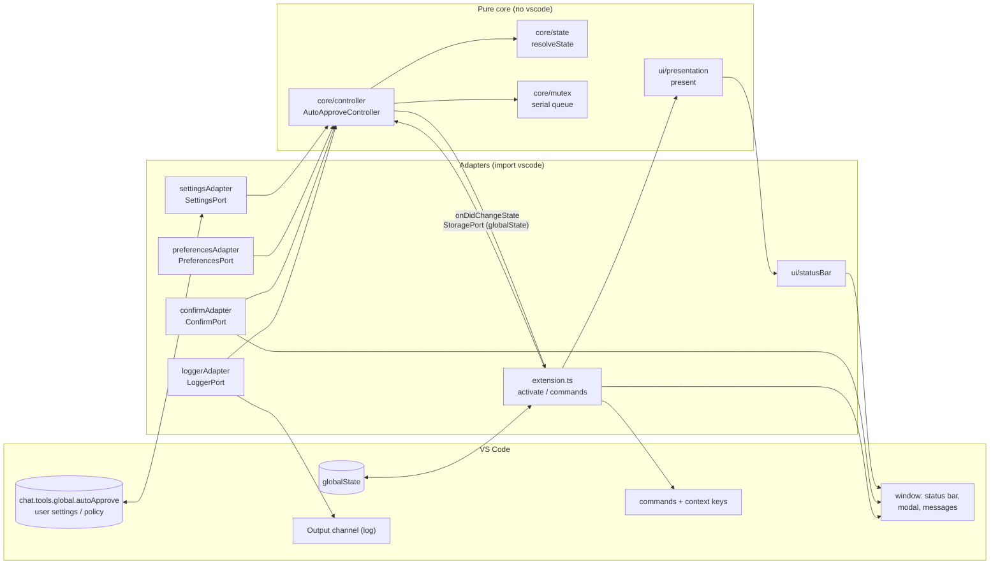
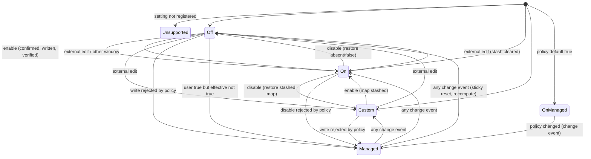
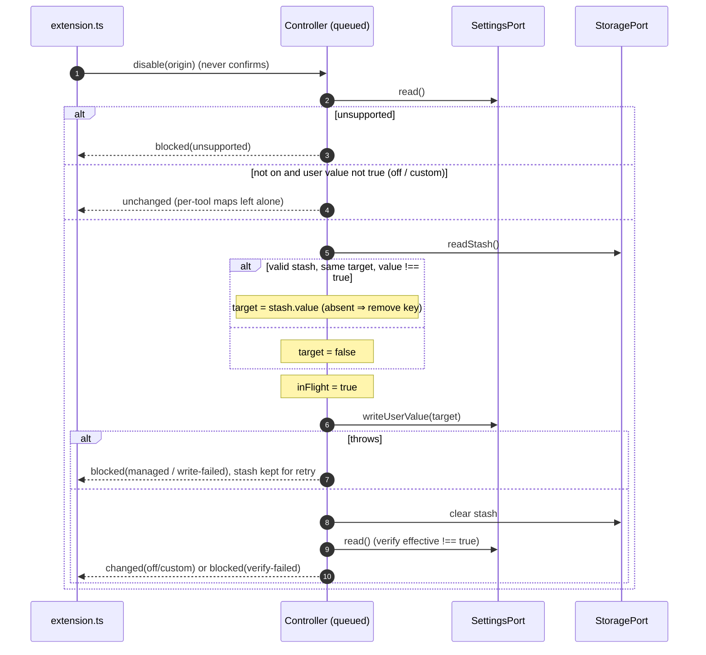

# Architecture

Copilot Auto-Approve Toggle is a small extension built as **ports and adapters**: all decisions live in pure TypeScript
(`src/core`, `src/ui/presentation.ts`) that never imports `vscode`; thin adapters connect that logic to the VS Code API.
This keeps the risky logic fast to test exhaustively (see [TEST-STRATEGY.md](TEST-STRATEGY.md)).

## Components



## Modules

| Module                               | Responsibility                                                                                                                                                                                                                                                                          |
| ------------------------------------ | --------------------------------------------------------------------------------------------------------------------------------------------------------------------------------------------------------------------------------------------------------------------------------------- |
| `src/core/types.ts`                  | Frozen contract: snapshot, state, outcomes, ports, view model, public API.                                                                                                                                                                                                              |
| `src/constants.ts`                   | Setting ids, command ids, context key, storage keys, output channel name.                                                                                                                                                                                                               |
| `src/core/state.ts`                  | `resolveState(snapshot, stickyManaged)` — maps raw values to `on/off/custom/unsupported` + `managed`, `userSettingOn`, `customToolCount`. Pure, never mutates input.                                                                                                                    |
| `src/core/mutex.ts`                  | Serial FIFO queue; one operation at a time; a failing task doesn't break the queue.                                                                                                                                                                                                     |
| `src/core/controller.ts`             | `AutoApproveController`: `initialize`, `enable`, `disable`, `toggle`, change listener, stash, sticky managed, logging.                                                                                                                                                                  |
| `src/ui/presentation.ts`             | `present(state, { remote })` → status bar text, tooltip markdown, aria label, background, command; `describeOutcome` → feedback. Pure.                                                                                                                                                  |
| `src/adapters/settingsAdapter.ts`    | Reads a fresh `getConfiguration('chat.tools.global')` each time; writes `ConfigurationTarget.Global`; filters change events; computes `targetId` on every access.                                                                                                                       |
| `src/adapters/preferencesAdapter.ts` | Reads `copilotAutoApproveToggle.confirmBeforeEnabling` (invalid ⇒ `firstTime`).                                                                                                                                                                                                         |
| `src/adapters/confirmAdapter.ts`     | Modal warning with a single **Turn On** action; `true` only for that action.                                                                                                                                                                                                            |
| `src/adapters/loggerAdapter.ts`      | Log output channel "Copilot Auto-Approve Toggle" (also records activation time in ms).                                                                                                                                                                                                  |
| `src/ui/statusBar.ts`                | Owns the `StatusBarItem`; applies the view model; adds the nonce to toggle clicks; trusted-command tooltip; honours `showStatusBarItem` live.                                                                                                                                           |
| `src/extension.ts`                   | Wires everything, registers 5 commands, maps outcomes to UI (one notification per coalesced toggle), maintains the `copilotAutoApproveToggle.mode` context key, logs activation time, returns `ExtensionApi { getState }` (plus `testing.statusBarNonce` only in `ExtensionMode.Test`). |

## State model

The status bar shows one of six presentations. `unsupported` beats `managed`, which beats the mode; managed + on is
shown as **On (Managed)**.



| State             | Meaning                                                                                                                                                                                                                                           | Click does                                                 |
| ----------------- | ------------------------------------------------------------------------------------------------------------------------------------------------------------------------------------------------------------------------------------------------- | ---------------------------------------------------------- |
| Off               | Effective value is not `true` and not a map with enabled tools.                                                                                                                                                                                   | Turn on (with warning per settings).                       |
| On                | Effective value is `true`.                                                                                                                                                                                                                        | Turn off and restore the previous value.                   |
| Custom (N tools)  | Effective value is a per-tool map with N tools set to `true`.                                                                                                                                                                                     | Turn on for all tools (map is stashed and restored later). |
| Managed           | Organization policy controls the value: user settings say `true` but effective isn't, or a write was rejected by policy (sticky until the next change event). Status `$(lock) Auto-Approve: Managed`, "Controlled by your organization's policy." | Open the setting.                                          |
| On (Managed)      | Policy forces auto-approve on (inspected default is `true`). Status `$(lock) Auto-Approve: On (Managed)`, warning background, "Your organization's policy turns auto-approve on for all tools."                                                   | Open the setting.                                          |
| Unsupported (N/A) | `chat.tools.global.autoApprove` isn't registered in this build.                                                                                                                                                                                   | Open the setting.                                          |

## Enable flow

```mermaid
sequenceDiagram
  autonumber
  actor U as User
  participant SB as Status bar
  participant EXT as extension.ts
  participant C as Controller (queued)
  participant S as SettingsPort
  participant K as StoragePort
  participant D as ConfirmPort

  U->>SB: click (args: [nonce])
  SB->>EXT: toggle(nonce)
  EXT->>C: toggle('statusBar')  (palette/keybinding/other ext ⇒ 'external')
  C->>S: read()
  alt unsupported / already on / managed
    C-->>EXT: blocked / unchanged / blocked(managed)
  else off or custom
    opt user value unset / null / primitive (never a per-tool map)
      C->>S: writeUserValue(current value)  (identity probe)
    end
    alt probe throws
      C-->>EXT: blocked(managed if /polic/i, else write-failed), raw detail — no dialog
    else probe ok or skipped
      opt origin external, or mode always, or firstTime without acknowledgement
        C->>D: confirmEnable()
        D-->>C: false or throws ⇒ cancelled
        C->>K: riskAcknowledged = true  (throws ⇒ blocked(write-failed), nothing written)
      end
      C->>S: read()  (re-check: unsupported ⇒ blocked, managed ⇒ blocked(managed), on ⇒ unchanged)
      C->>K: stash {v:1, target, value?} at stash.v1/<targetId>  (throws ⇒ blocked(write-failed), nothing written)
      Note over C: inFlight = true
      C->>S: writeUserValue(true)
      S-->>C: (this window's change event fires here; listener sees inFlight)
      alt write throws
        C->>K: clear stash
        C-->>EXT: blocked(managed / write-failed)
      else
        C->>S: read()  (verify effective === true)
        alt not true
          C->>S: writeUserValue(stash value)  (best effort)
          C->>K: clear stash
          C-->>EXT: blocked(verify-failed)
        else
          C-->>EXT: changed(on)
        end
      end
    end
  end
  EXT->>SB: present(state)
  EXT-->>U: status bar message (3 s) or warning (base message + raw VS Code error only when VS Code returned one) with Open Setting / Show Log
```

After a turn-on VS Code itself shows **"Enable global auto approve?"** on the first tool call. That prompt belongs to
VS Code and is never automated or suppressed.

## Disable flow



## Concurrency model

- **One queue.** `initialize`, `enable`, `disable` and `toggle` all run through a FIFO mutex, so two operations never
  interleave. Every decision is taken on a fresh `read()` inside the queue, never on cached state.
- **Toggle coalescing.** While a toggle is queued or running (including while its dialog is open), further `toggle()`
  calls return the same promise. Ten rapid clicks are one toggle. Direct `enable()`/`disable()` calls are never
  coalesced; they queue behind it. Callers sharing a coalesced toggle get the same outcome object, and
  `extension.ts` shows feedback for it once, so a double-click produces one notification.
- **`inFlight`.** Set immediately before our write, cleared when the operation settles. VS Code fires this window's
  configuration event before `update()` resolves, so the change listener uses `inFlight` to tell our own write apart
  from an external one.
- **Change listener** (not queued): resets sticky managed; if not in flight and the user value is no longer `true`, the
  stash is stale (someone else turned it off) and is cleared; state is recomputed and an event is emitted only if one of
  `mode`, `customToolCount`, `managed`, `userSettingOn` changed.
- **Multiple windows.** Each window runs its own controller. Settings changes reach other windows as configuration
  events; `globalState` (stashes, acknowledgement) is shared, with one stash key per target (see below).
- **Dispose.** Listeners are removed; operations already queued may finish but never produce unhandled rejections.

## Remote windows and targets

`chat.tools.global.autoApprove` is an application-machine setting: in a remote window (SSH, WSL, Dev Container,
Codespaces) a user-settings write lands in the **remote** machine's settings. The extension runs on the UI side
(`extensionKind: ["ui"]`), so its `globalState` is shared between local and remote windows.

To avoid restoring one machine's value onto another, stashes are stored **per target** under
`copilotAutoApproveToggle.stash.v1/<targetId>`, where `targetId` is `'local'` or
`remote:<remoteName>:<authority of the first workspace folder>`. `targetId` is recomputed on every access (a folder can
be added to an empty remote window after activation). Each stash also records its `target`; a stash whose `target`
doesn't match its key is ignored and cleared. Local and remote windows therefore never clobber each other's stash, and
invariant I2 (a stash exists only while that target's user value is `true`) holds per target. Turning off without a
matching stash writes `false`. Startup only cleans up the current target's stash when it is stale.

## Security model

| Concern                                       | Design                                                                                                                                                                                                                                                                                                                                                                                                                        |
| --------------------------------------------- | ----------------------------------------------------------------------------------------------------------------------------------------------------------------------------------------------------------------------------------------------------------------------------------------------------------------------------------------------------------------------------------------------------------------------------- |
| VS Code's own safety prompt                   | Never automated, never suppressed. The extension never writes `chat.tools.global.autoApprove.optIn` storage or VS Code's internal context keys.                                                                                                                                                                                                                                                                               |
| Organization policy                           | Detected with an identity write before any dialog — only when the user value is unset, `null` or a primitive (a per-tool map is never re-serialized before the user confirms) — and re-checked after the dialog. If policy rejects writes the extension reports **Managed** and stops; it never retries via another path. I8: policy-locked ⇒ no dialog and nothing written except the identity probe (when a probe applies). |
| Silent enabling by other extensions or agents | Commands are public, but any invocation without the status bar's per-activation nonce is `external` and always shows the modal warning. The nonce is a `crypto.randomUUID()` held in memory and only attached to the status bar item's command; it is not logged or stored, and is exposed through the API only as `testing.statusBarNonce` when the extension runs in `ExtensionMode.Test` (integration tests).              |
| Malicious workspaces                          | The auto-approve setting and both extension settings are application-scoped, so a repository's `.vscode/settings.json` can't turn auto-approve on or turn the warning off.                                                                                                                                                                                                                                                    |
| Tooltip links                                 | The tooltip `MarkdownString` trusts only four commands: `copilotAutoApproveToggle.openSetting`, `copilotAutoApproveToggle.toggle`, `workbench.action.openSettingsJson`, `workbench.action.openRemoteSettingsFile` (used for the leftover-`true` hint in remote windows).                                                                                                                                                      |
| Public API                                    | In production `activate()` returns exactly `{ getState }` (frozen, read-only). `testing: { statusBarNonce }` is added only when `context.extensionMode === ExtensionMode.Test`, because VS Code refuses modal dialogs under `--extensionTestsPath`.                                                                                                                                                                           |
| Privacy                                       | No telemetry and no network access. Logs contain mode, counts, origin, outcome and VS Code error messages — never setting values or tool names.                                                                                                                                                                                                                                                                               |
| Writes                                        | Only `chat.tools.global.autoApprove` in user settings, plus `globalState` keys (one stash per target, acknowledgement). If storing the stash or acknowledgement fails, nothing is written to settings (`blocked/write-failed`). A failed disable keeps the stash.                                                                                                                                                             |

Threat model and reporting: [SECURITY.md](../SECURITY.md).
